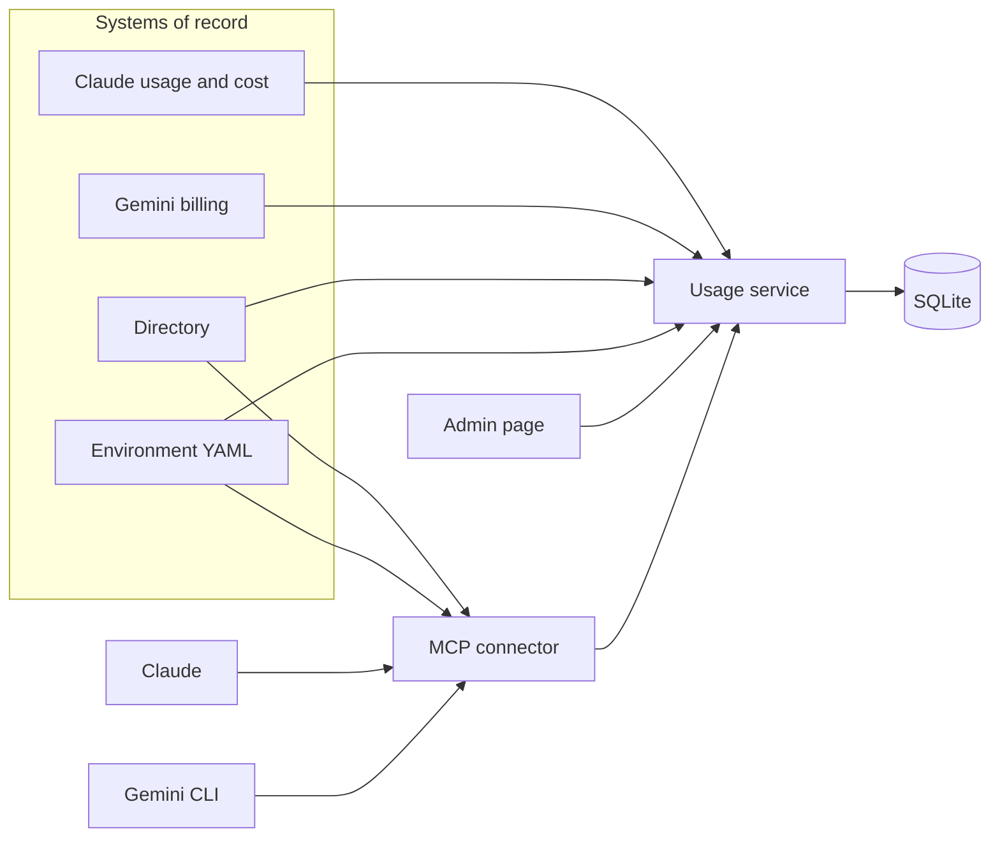

# Meridian usage

Assignment ID: **Fullstack-ClaudeGemini-UsageConnector-v1**

A usage service for Meridian Life Sciences, and the connector that lets a team lead ask the assistant about their own team. The service ingests the Claude and Gemini exports in the starter kit. The connector refuses anything the caller's role cannot see, and it refuses in code, before it fetches numbers.

The note for team leads is [docs/note-to-team-leads.md](docs/note-to-team-leads.md). The tool transcript is [docs/transcript.md](docs/transcript.md).

## Setup

Python 3.9 or newer, and Node 22.

```bash
python3 -m venv .venv
source .venv/bin/activate
pip install -r requirements.txt
pytest

cd connector
npm ci
npm test
npm run build
cd ..

PYTHONPATH=service python -m provision
MERIDIAN_ENV=prod PYTHONPATH=service python -m meridian
```

The admin page is [http://127.0.0.1:8000](http://127.0.0.1:8000). The "Viewing as" menu is the simulated identity. It sends `X-User-Id`. Priya Nair is the default: team lead, Clinical Operations, production rules.

`MERIDIAN_ENV` is `dev`, `staging`, or `prod`. It selects `starter-kit/environments/<name>.yaml`. The database defaults to `var/meridian.db`. Usage is rebuilt from the exports on every start. Capability rows are kept. Start the service with the environment you want the assistant to use. The connector has to name that same environment.

### Claude Code

Build the connector (`npm run build` in `connector/`), start the service, then start Claude from this repository:

```bash
claude --plugin-dir connector
```

`--plugin-dir` is relative to the directory you are in. Run that command here, not inside `connector/`. From inside `connector/`, the path `connector` is not the plugin, and Claude also reads `.mcp.json` as a project server. A project server does not set `CLAUDE_PLUGIN_ROOT`, so the server command never resolves.

The plugin asks for three values the first time it is enabled, and it passes them to the server. They are not tool arguments, and the model cannot change them.

| Plugin setting | Server variable | What to enter |
| --- | --- | --- |
| Directory user id | `MERIDIAN_ACTOR_USER_ID` | A user id from the directory. Priya Nair, team lead of Clinical Operations, is `user_E7691888F28227066DD2FB86`. |
| Environment | `MERIDIAN_ENV` | `dev`, `staging`, or `prod`. The default is `prod`. It must match the service. |
| Usage service URL | `MERIDIAN_API_URL` | `http://127.0.0.1:8000`, unless the service is elsewhere. |

`MERIDIAN_ROOT` is the session's project directory. The connector reads `starter-kit/` from there, so the session has to be this checkout. Change the three values later from `/config`.

### Gemini CLI

The same directory is a Gemini CLI extension. Gemini does not pass the shell environment through to an extension server. The manifest declares the directory user, the environment, and the service URL, and it sets `MERIDIAN_ROOT` from the workspace path.

Install Gemini CLI, then link the extension from this repository:

```bash
npm install -g @google/gemini-cli
gemini extensions link connector
gemini extensions config meridian-usage
```

Start Gemini from this repository, not from `connector/`:

```bash
gemini
```

`MERIDIAN_ROOT` is that workspace. The service has to be running with the same environment name. When the config command asks, use the same three values as the Claude plugin. A blank environment means `prod`. A blank service URL means `http://127.0.0.1:8000`. The directory user has no default.

`build/environments/<env>/gemini_cli_settings.json` is the other registration. Merge that fragment into Gemini `settings.json` when you are not using the extension. It points at `connector/dist/index.js` in this checkout and leaves `MERIDIAN_ACTOR_USER_ID` empty for you to fill in. Do not merge the prod fragment while the extension is enabled: both are named `meridian-usage`, and a `settings.json` server replaces the extension server.

In `dev`, a member can read every group, and a team lead can change their own group's capabilities. In `staging`, a team lead reads and changes only their own group. In `prod`, a team lead reads only their own group, and only a platform admin can change a capability. The grants are in the table under Permission model.

With the service running, the three tool calls in the transcript are:

```bash
cd connector && npm run transcript
```

## Architecture



The service is Python. The connector is TypeScript. They both read the directory and the environment file. The connector also calls the service over HTTP, and it sends only the user id it was started with. A tool argument cannot name a different person.

`python -m provision` reads the three environment files and writes, under `build/environments/<env>/`:

- `permissions.json`, with every group's capability default expanded to a boolean
- `claude_desktop_config.json`, a local stdio server for Claude Desktop. It sets `MERIDIAN_ENV`, `MERIDIAN_ROOT`, and `MERIDIAN_API_URL` for that environment, and leaves `MERIDIAN_ACTOR_USER_ID` empty
- `gemini_cli_settings.json`, the `mcpServers` fragment for Gemini CLI. It sets `MERIDIAN_ENV`, `MERIDIAN_ROOT`, and `MERIDIAN_API_URL` for that environment, points at the built connector, and leaves `MERIDIAN_ACTOR_USER_ID` empty. `${extensionPath}` is not used here, because Gemini substitutes that only inside an extension manifest

The command checks the rendered files against the grants in the starter kit. Prod write access has to be `platform_admin` only. Prod `usage-connector` has to be on only for `it-platform` and `clinical-operations`. A widened manifest fails the command, and CI runs it.

## Mapping

One fact per platform, user, group, day, model, and product. Claude's product is `chat`, `claude_code`, or `cowork`. Gemini has no product, so the product column is the `agent` label.

Claude tokens. Input is uncached input, plus cache reads, plus both cache-creation buckets (5-minute and 1-hour). On every row in this export that sum plus `output_tokens` equals `total_tokens`, and ingest refuses the file if a row breaks that. I keep the reported `total_tokens` rather than inventing a new definition.

Claude cost. The cost report is a second file. `amount` is a decimal string of cents, so `"88.900050"` is `$0.88900050`. Rows join to usage on user, day, product, model, and RBAC group. Token cost and web-search cost are summed into one `cost_usd`. Web-search requests stay on the fact; they are not tokens. Every usage row in this export has a cost row and the other way around. A mismatch fails ingest.

Gemini. `usage.amount` is the token count. The SKU description says input or output. `cost` is already USD. Owner email and `project.id` pick the user and the group. The project `team` label has to agree with the directory group. Billing has no request count, so `requests` is null. Input and output rows for the same person, day, model, and agent collapse into one fact.

People. Claude's `actor.user_id` and `rbac_group_id`, and Gemini's `owner` label and `project.id`, are the only attribution keys. The user's directory group has to be the group those keys resolve to. A row that points at someone else's group is an ingest error, not a fact with a warning on it.

Weeks are ISO weeks of the usage day. The export runs from 2026-08-03 through 2026-09-27, which is 2026-W32 through 2026-W39. `last_7_days` and `last_30_days` are counted back from 2026-09-28, the first day after the export, not from the wall clock. A week such as `2026-W36` is that Monday through the next Monday, exclusive. A month such as `2026-09` is the calendar month.

## Permission model

The environment file is the grant. Two scopes:

| | dev | staging | prod |
| --- | --- | --- | --- |
| `usage:read` | member, team lead, platform admin | team lead, platform admin | team lead, platform admin |
| who they can read | any group | own group; admins read all | own group; admins read all |
| `capabilities:write` | team lead, platform admin | team lead, platform admin | platform admin |

A team lead or a member who has write access can change their own group only. The YAML never says a lead may edit another team, including in dev, where reads are open. Platform admins can change any group.

Checks, in order, for every connector tool:

1. The arguments are the right shape. A bad period is `invalid_argument`, not a denial.
2. The caller's role has the tool's scope. If not, the denial names `required_scope`.
3. The group is one they may see, or write. Omitted group means their own group.
4. `usage-connector` is enabled for their own group. This is the caller's group, not the group they asked about, so an admin in IT Platform can ask about Finance while the connector is on for IT Platform.
5. Only then does the connector fetch usage or write a capability.

A denial is `{"error":"permission_denied","reason":"..."}` and, where the role lacks the scope, `required_scope`. It contains no usage. The same function backs the admin API, which returns HTTP 403 with that body.

The admin page is not blocked by the `usage-connector` flag. If it were, nobody could turn the flag back on. The connector is blocked by it. That split is the point of the flag: the control plane stays up, the assistant goes quiet.

Both sides enforce this. The connector does not trust the service to have filtered the response, and the service does not trust the connector to have checked. The tests that matter are the ones where a fake client throws if it is called: a cross-group read, a member read in prod, and a team-lead write never touch it.

## What I ran, and on which platform

The connector is packaged for both hosts, because the brief asks for both.

- Claude plugin: `connector/` with `.claude-plugin/plugin.json`, `.mcp.json`, and `skills/meridian-usage/SKILL.md`. The server command is `node ${CLAUDE_PLUGIN_ROOT}/dist/index.js`. Load it from this repository with `claude --plugin-dir connector` once `dist/` is built. `userConfig` supplies the directory user, `dev` / `staging` / `prod`, and the service URL. Claude substitutes those into the stdio server's `env`, along with `MERIDIAN_ROOT` from the project directory. The model still has no argument that names a person. A user id is not written into the plugin or into the rendered manifests.
- Claude Desktop local server: `build/environments/<env>/claude_desktop_config.json`. Fill in `MERIDIAN_ACTOR_USER_ID`. The rendered file leaves it empty on purpose.
- Gemini CLI extension: `connector/gemini-extension.json`, with `GEMINI.md` as the context file. Link it with `gemini extensions link connector` from this repository. The settings are the directory user, `dev` / `staging` / `prod`, and the service URL. Gemini allowlists only declared settings, so those three are named in the manifest and passed through on the server `env`. `MERIDIAN_ROOT` is the workspace path, which is why Gemini has to be started here. The rendered `gemini_cli_settings.json` is the settings.json registration for one environment, with the user id left empty.

I ran the service and the admin page locally (Python 3.9.6, Node 22.18). CI is set up for Python 3.11 and Node 22. I exercised the page as Priya (her group only, toggles disabled), as Daniel Okafor (member, usage refused, group and week lists empty), and as Chloe Dubois (every group, a capability toggle that persisted and that I then set back). I ran the connector tests against a live server, including Priya's allowed read, her finance denial, and her refused write. The numbers in the transcript are from that path.

I did not get a Claude Desktop or Claude Code conversation. `claude -p` with the local MCP config returned `401` on the OAuth token before a tool ran. I did drive that same server over stdio as Priya in prod: September for Clinical Operations, a finance denial with no figures, and a refused web-search change. Gemini CLI 0.63.0, linked to `connector/` and signed in with a Gemini API key, answered the September question and refused the web-search change in the same words. Personal Google sign-in is no longer accepted for individual accounts. The transcript is [docs/transcript.md](docs/transcript.md).

## Decisions

SQLite, rebuilt usage, kept capabilities. The exports are a few thousand rows, and a warehouse is more moving parts than they need. Rebuilding usage on start means a mapping fix shows up on the next boot. Capabilities survive because they are the thing a person changed.

Money stays in `Decimal` until the JSON boundary. The tool schema wants a number, so the API emits a float quantized to eight decimal places, which is enough for Claude's fractional cents. I would rather have sent a decimal string. The schema says number, so the float is the contract.

The connector's identity is fixed at process start. Putting a user id on the tool would mean the model picks who it is. The admin page is the opposite on purpose: a switcher, because that page is how we look at the policy. The switcher is not authentication. It is a stand-in, and it is labelled as one.

`requests` for a Gemini total is null, not zero. Zero would say we observed no requests. We observed no request field.

## Standards

Followed: one module per concern in the service; ingest fails closed; permission checks have denial tests that assert the absence of figures; the three environments are rendered by one command and CI runs the tests and that command; the connector and the service can disagree only by bug, and the connector still refuses on its own.

Skipped: a formatter and a linter in CI. `tsc --strict` and pytest are the gates. I skipped a shared policy package across the two languages, an OpenAPI client, and an `.mcpb` one-click bundle. The plugin plus the generated desktop config cover registration. An `.mcpb` would be the nicer Desktop install, and I did not build one. I also skipped product and model breakdowns on the admin page. They are on the fact, and they are tested, and the page the brief asked for is platform, group, and week.

## How I used AI tools

I wrote this in Cursor with Grok. The agent drafted the service, the connector, the page, and this README. The ingest tests recompute Claude's token identity and the cent conversion from the raw files, and they recompute the Gemini cost the same way, so a wrong join fails even if the surrounding code looks finished. The permission order (scope, then group, then the connector flag, and no fetch before a denial) is the rule I wanted held, including the rule that a lead with write access can edit only their own group in dev. A check that lived only in the prompt would not have been acceptable.

## With more time

A test that the Python and TypeScript denial strings cannot drift. They are copied, with a comment, and that is the brittle part.

Incremental ingest, with a watermark, instead of deleting the usage table on boot.

The admin page showing model and product, and a CSV export for finance.

An `.mcpb` for Desktop, and a real `claude -p` recording once a token works.

Audit rows for capability changes beyond `updated_at` and `updated_by`.

## In the real enterprise version

The header goes away. The caller is the person the identity provider says they are, from the host's OAuth token or a headers-helper that mints a short-lived assertion. The directory file becomes the SCIM sync we already pretend it is. Group membership can change during the day, and a person can be in more than one group; this export has exactly one group per person, and the code takes the first.

The connector is registered once, in the organisation connector registry, and pushed with `managedMcpServers` or an organisation plugin. Dev, staging, and prod are separate registrations with the rendered manifest mounted in, not a YAML file from a git checkout sitting on a laptop. The host can also lock `set_capability` with a tool policy. That lock is useful, and it is not sufficient. The server still has to refuse, because a tool policy is a client setting and clients get copied.

Usage stops being a file in the repo. Claude comes from the Enterprise Analytics API, paged, with `has_more`. Gemini comes from the BigQuery billing export on a schedule, and billing rows arrive late, get credited, and sometimes change currency. The fact table needs a reload of a closed day, and a cost that is not final yet should be marked that way. Empty credits in this sample are why I could treat `cost` as the number to store.

The SQLite file becomes a Postgres or warehouse table behind the same API. The capability rows stay in the service, with an audit log, and they are separate from the registry grant. A team can be allowed to install the connector and still have `usage-connector` turned off for them. Either one saying no means the tool returns a denial. The flag we have now is the second of those two, and it is the one the assistant actually hits.
